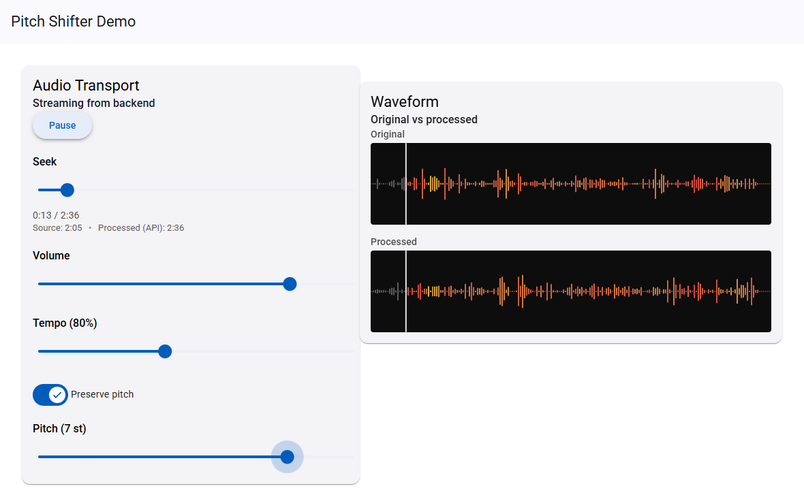
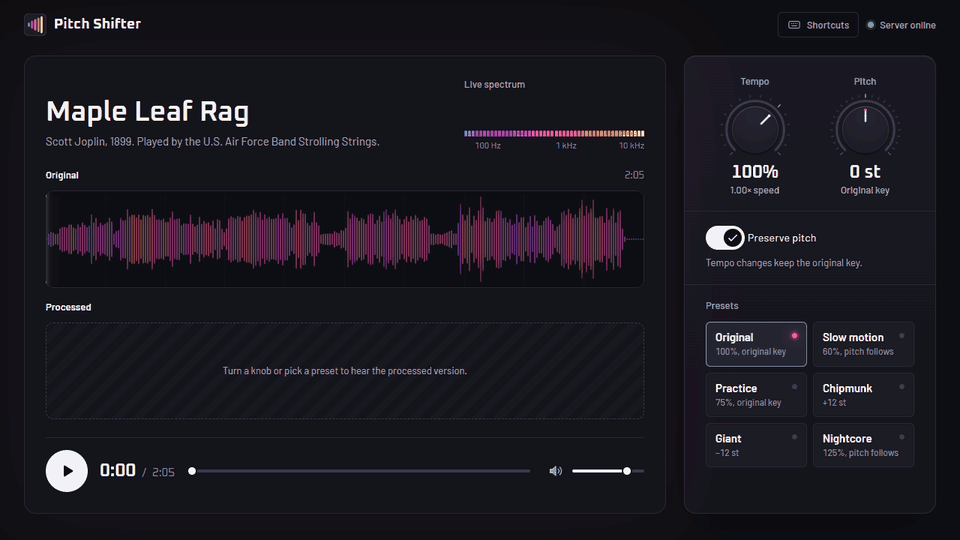
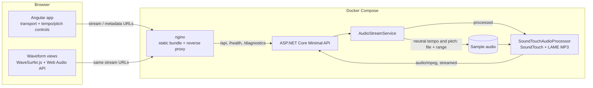

# Pitch Shifter Demo

[](https://github.com/julipetric/pitch-shifter-demo/actions/workflows/ci.yml)

Change the pitch and tempo of a track on the server while it streams, and watch the original and
processed waveforms side by side in the browser. Angular 19 + ASP.NET Core 8, one `docker compose up` away.



<details>
<summary>Animated walkthrough</summary>



</details>

## Features

- **Tempo 50 to 125 % and pitch -12 to +12 semitones** (half-semitone steps), adjusted from sliders.
  With *Preserve pitch* on, tempo and pitch are independent; with it off, tempo behaves like a
  playback-rate change and the pitch follows.
- **Processing on the server.** The API time-stretches and pitch-shifts with SoundTouch, encodes the
  result to MP3 with LAME and streams it while it is being produced.
- **Waveform comparison.** Original and processed audio are drawn side by side. Each bar is coloured by
  the dominant frequency of its time segment (a chunked FFT in the browser), and a cursor follows
  playback.
- **Seek, volume and duration display.** Seeking a processed stream restarts it at the requested
  offset; the metadata endpoint reports the processed duration for the chosen tempo.
- **Self-contained fallback.** If no sample is available the API serves a generated 5-second 440 Hz tone.
- **Stateless API** with centrally validated parameters and an `IAudioProcessor` abstraction around the
  processing library.

## Architecture



1. The browser loads the Angular bundle from nginx and calls the API on the same origin.
2. `AudioApiService` builds `/api/audio/stream?...` and `/api/audio/metadata?...` URLs from the current
   tempo, pitch and preserve-pitch values. Tempo changes are debounced and pitch changes apply when the
   slider is released; either one reloads the stream.
3. For neutral parameters the API serves the sample file as it is, with range support. Otherwise
   `AudioStreamService` decodes the sample, `SoundTouchAudioProcessor` processes and encodes it on a
   background task, and the HTTP response reads from a pipe, so bytes flow while encoding continues.
4. The `<audio>` element plays the stream; two WaveSurfer.js views load the original and the processed
   stream, and `WaveformFrequencyService` colours the bars.

More detail: [docs/ARCHITECTURE.md](docs/ARCHITECTURE.md) and [docs/STACK.md](docs/STACK.md).

## Quick start

Requires Docker with Compose.

```bash
git clone https://github.com/julipetric/pitch-shifter-demo.git
cd pitch-shifter-demo
docker compose up --build
```

Open <http://localhost:8080>, press **Play**, then move the **Tempo** and **Pitch** sliders. Use
`APP_PORT=9000 docker compose up --build` for another host port, and `docker compose down` to stop.

Swagger UI is at <http://localhost:8080/swagger>.

## Manual development setup

Requires the .NET 8 SDK and Node.js 20 or 22 (`scripts/dev-setup.sh` / `scripts/dev-setup.ps1` check for
the tools and can install them; see [docs/SETUP.md](docs/SETUP.md)).

```bash
# terminal 1: API on http://localhost:5041
dotnet run --project backend/pitch-shifter-demo-backend

# terminal 2: Angular dev server on http://localhost:4200
cd frontend
npm ci
npm start
```

The dev build calls `http://localhost:5041`, and the API allows the origin `http://localhost:4200` by
default. Encoding processed audio needs the native LAME library: Windows works out of the box; on Linux
or macOS use the Docker setup above. Details: [backend/README.md](backend/README.md),
[frontend/README.md](frontend/README.md).

## API reference

Interactive documentation is served at `/swagger`.

| Endpoint | Description |
|----------|-------------|
| `GET /api/audio/stream` | The default sample, processed according to the query parameters below. |
| `GET /api/audio/metadata` | `{ "sourceDurationSeconds": n, "processedDurationSeconds": n }` for the same parameters. |
| `GET /health` | `{ "status": "ok" }` |
| `GET /diagnostics/audio` | How the sample path and file were resolved (configuration, resolved paths, existence). |

| Query parameter | Default | Range |
|-----------------|---------|-------|
| `tempoPercent` | `100` | 50 to 125 |
| `pitchSemitones` | `0` | -12 to 12, in steps of 0.5 |
| `preservePitch` | `true` | `true` or `false` |
| `startSeconds` (stream only) | `0` | 0 or more, on the processed timeline |

Out-of-range values return `400` with `{ "error": "..." }`.

```bash
# 80 % tempo, up 3 semitones, starting 30 s into the processed audio
curl -o out.mp3 "http://localhost:8080/api/audio/stream?tempoPercent=80&pitchSemitones=3&startSeconds=30"

curl "http://localhost:8080/api/audio/metadata?tempoPercent=80"
```

Neutral parameters (`tempoPercent=100`, `pitchSemitones=0`) return the sample file itself with HTTP range
support. Any other combination returns a 128 kbps `audio/mpeg` stream without range support.
Configuration keys (`Audio:*`, `Cors:AllowedOrigins`, `Swagger:Enabled`, ...) are listed in
[backend/README.md](backend/README.md#configuration).

## Key technical decisions

- **Streaming through a pipe.** Processing and MP3 encoding run on a background task that writes into a
  `System.IO.Pipelines` pipe; the response reads from the other end. Playback can start before the whole
  file has been processed, and the encoded output is never buffered in full.
- **Seeking by re-requesting.** A processed stream has no known length and no range support, so a seek
  asks for a new stream with `startSeconds`. The offset is converted from the processed to the source
  timeline using the tempo ratio.
- **Validation in one place.** `AudioProcessingParameters.TryCreate` owns the ranges and step size and is
  shared by the stream and metadata endpoints.
- **Managed MP3 decoding.** NLayer decodes MP3 input, so the API does not depend on an operating-system
  codec.
- **Swappable processing.** `IAudioProcessor` separates the HTTP layer and `AudioStreamService` from
  SoundTouch, so another algorithm can be plugged in.
- **Responsive UI.** An `OnPush` waveform component, `@defer` for the waveform views, a debounced stream
  reload, a facade service that cancels stale metadata requests with `switchMap`, and frequency analysis
  that works in small chunks, yields to the main thread between them and can be aborted.
- **Same origin by default.** The production bundle uses an empty API base URL, resolved against the
  page origin, and nginx proxies the API, so no CORS setup is needed. Another origin is a build-time
  setting (`AUDIO_API_BASE_URL`) plus `Cors:AllowedOrigins` on the API.
- **Graceful degradation.** If the sample is missing or cannot be decoded, a generated tone is served;
  if processing cannot start, the original file is streamed.

## Testing

```bash
# backend: xUnit, including in-process HTTP tests
dotnet test backend/PitchShifterDemo.sln
docker build --target test ./backend          # the same suite in Docker

# frontend: Jasmine + Karma in headless Chromium/Chrome
cd frontend && npm run test:ci
```

Karma uses the browser named by `CHROME_BIN`; any Chromium-based browser works (for example Microsoft
Edge). GitHub Actions ([`.github/workflows/ci.yml`](.github/workflows/ci.yml)) builds and tests the
backend, builds and tests the frontend on Node 20 and 22, then starts the Docker Compose stack and checks
the shell, the proxied API and a processed MP3 stream.

## Project structure

```
.
├── backend/
│   ├── PitchShifterDemo.sln
│   ├── Dockerfile
│   ├── pitch-shifter-demo-backend/        ASP.NET Core 8 Minimal API
│   │   ├── Program.cs                     endpoints, CORS, Swagger
│   │   ├── Options/                       configuration binding
│   │   ├── Services/                      parameters, stream service, SoundTouch processor
│   │   └── Content/Samples/               bundled sample audio and its license
│   └── pitch-shifter-demo-backend.Tests/  xUnit tests
├── frontend/                              Angular 19 app (Angular Material, WaveSurfer.js)
│   ├── Dockerfile
│   ├── nginx/default.conf.template        static hosting + API proxy
│   └── src/app/                           components, services, pipes, waveform, specs
├── docs/                                  architecture, stack, setup, deployment, images
├── openspec/                              specifications and archived change proposals
├── scripts/                               developer environment bootstrap (PowerShell, bash)
├── .github/workflows/ci.yml
├── docker-compose.yml
├── CHANGELOG.md
└── LICENSE
```

### Spec-driven workflow

The project was built with [OpenSpec](https://github.com/Fission-AI/OpenSpec): each feature starts as a
change proposal with design notes, tasks and delta specs, and is archived into the main specs once it
ships. `openspec/specs/` holds the current capabilities (audio stream endpoint, audio processing service,
frontend transport, waveform analyzer, ...) and `openspec/changes/archive/` the history of each change.
`openspec init` regenerates the editor integration in `.cursor/`, which is not tracked.

## Deployment

`docker compose up --build` is the supported way to run the whole app on any host with Docker. A split
layout (Azure Static Web Apps for the bundle, Azure App Service for the API) is documented in
[docs/DEPLOYMENT.md](docs/DEPLOYMENT.md), with step-by-step guides for
[the backend](docs/AZURE-BACKEND-DEPLOY.md) and [the frontend](docs/azure-frontend-deploy.md). There is
no hosted instance of this demo.

## Sample audio

The bundled track is *Maple Leaf Rag* (Scott Joplin, 1899), performed by the Strolling Strings of the
United States Air Force Band. The recording is a work of the U.S. federal government and in the public
domain; the composition's copyright has expired. Source: [Wikimedia Commons](https://commons.wikimedia.org/wiki/File:Maple_Leaf_Rag_-_Strolling_Strings_-_United_States_Air_Force_Band.mp3),
originally published by the [U.S. Air Force Band](https://www.music.af.mil/Multimedia/Music/Public-Domain-Music/).
See [`backend/pitch-shifter-demo-backend/Content/Samples/README.md`](backend/pitch-shifter-demo-backend/Content/Samples/README.md).

## License

[MIT](LICENSE) © 2026 Julian Petric. The bundled recording is in the public domain (see above).
