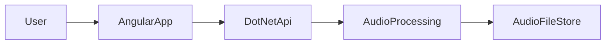
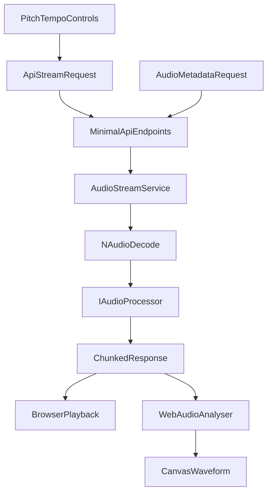

# Architecture for Pitch-Shifter Demo

This architecture follows the stack defined in `docs/STACK.md` and focuses on a backend-centric audio processing flow with an Angular client for controls and visualization.

## System context

## Core components
### Frontend (Angular)
- **Player UI** (`AppComponent`): play/pause, seek, volume, tempo/pitch sliders, preserve-pitch toggle. Tempo changes are debounced (300 ms) before the stream is reloaded.
- **Waveform UI** (`WaveformSnippetComponent`): two instances, original and processed. WaveSurfer.js loads and decodes the stream (Web Audio `decodeAudioData`) and draws bars on a canvas; `WaveformFrequencyService` computes a dominant frequency per time segment with an FFT (`OfflineAudioContext` + `AnalyserNode`) and the bars are coloured by it.
- **Audio API wiring** (`AudioApiService`, `AudioFacadeService`): the service builds `/api/audio/stream` URLs with processing params and fetches `/api/audio/metadata`; the facade holds the current parameters and exposes the metadata as an observable.
- **API base URL**: a build-time constant, empty by default so calls go to the origin that served the page.

### Backend (.NET)
- **Minimal API endpoints** (`Program.cs`): `/api/audio/stream`, `/api/audio/metadata`, `/health`, `/diagnostics/audio`.
- **AudioProcessingParameters**: validates and normalises tempo, pitch and preserve-pitch query values.
- **AudioStreamService**: resolves the sample file, serves it as-is for neutral parameters, delegates to the processor otherwise, and falls back to a generated tone when no usable sample exists.
- **IAudioProcessor** / **SoundTouchAudioProcessor**: pitch/tempo processing with SoundTouch, encoded to MP3 with LAME and written to a pipe that backs the HTTP response.
- **NAudio pipeline**: decodes source audio (NLayer's managed decoder for MP3, `WaveFileReader` for WAV).
- **Metadata endpoint**: `/api/audio/metadata` returns source/processed duration.

## Request and streaming flow

## Responsibilities and boundaries
- **Frontend**: user interaction, visualization, and lightweight audio analysis.
- **Backend**: heavy audio processing and streaming, stateless per request. Processed streams use MP3 for size and do not support range requests; seeking a processed stream reloads it with `startSeconds`.
- **Processing layer**: isolated behind `IAudioProcessor` so the SoundTouch-based implementation can be replaced (for example by a hand-written phase vocoder).

## Non-functional considerations
- **Latency**: chunked streaming, small buffers, async I/O.
- **Performance**: debounced slider events (RxJS).
- **Scalability**: stateless API, no in-memory session state.
- **Reliability**: if the source cannot be opened for processing, the original file is streamed; if no usable sample exists, a generated tone is served (configurable).

## Deployment layout
- **Docker Compose**: nginx serves the Angular bundle and proxies `/api`, `/health`, `/diagnostics` and `/swagger` to the backend container, so the browser uses a single origin.
- **Free-tier cloud**: frontend on Azure Static Web Apps (or Vercel/Netlify), backend on Azure App Service (or Render/Fly.io). The frontend is built with the backend's address and the backend lists the frontend origin under `Cors:AllowedOrigins`.
- **Notes**: expect cold starts; keep sample files small for demo. See [DEPLOYMENT.md](DEPLOYMENT.md).
